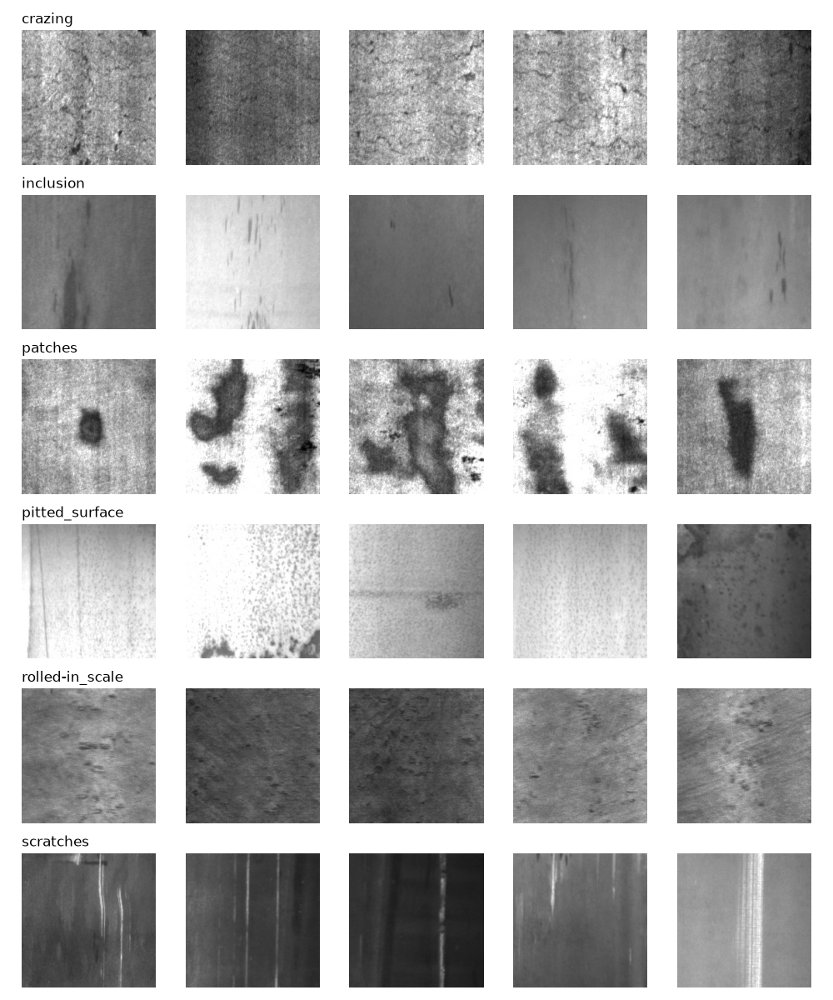
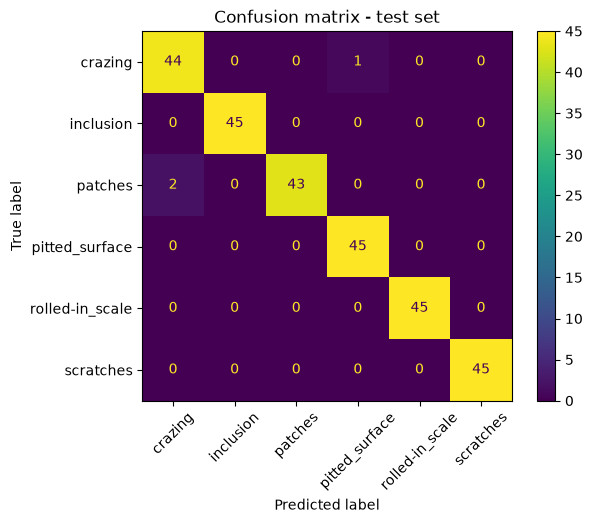

# Edge Defect Vision

Steel surface defect classifier: trained in PyTorch, exported to ONNX, then quantized and run from C++ on a laptop CPU.
**Status:** in progress. Data, training, evaluation and ONNX export done; INT8 quantization and C++ app next.

## Dataset
NEU surface defect database: 1,800 grayscale images, 6 classes, 300 per class.
Split 70 / 15 / 15 (train / val / test), stratified, fixed seed 42.

- **Crazing:** fine network of cracks across the surface
- **Inclusion:** small dark streaks or spots
- **Patches:** large dark blobs
- **Pitted surface:** many tiny dots
- **Rolled-in scale:** rough, smeared texture
- **Scratches:** long straight bright lines

## Training (A2)
- Model: MobileNetV3-Small, pretrained on ImageNet, last layer replaced with 6 outputs (transfer learning)
- Optimizer: Adam, batch size 32, 10 epochs, CPU only (Surface Pro, i5-7300U)
- Compared 3 learning rates in MLflow:

| Learning rate | Best val accuracy | Notes |
|---|---|---|
| 0.003 | 0.96 | least stable |
| 0.001 | 1.000 | dipped to 0.967 at epoch 8 |
| 0.0003 | 1.000 | stable at 1.000 from epoch 7, **chosen** |

## Evaluation (A3): test set, used once
**Test accuracy: 98.9% (267 / 270)**

Findings:
1. All 3 errors involve crazing: 2 patches images were predicted as crazing, and 1 crazing image as pitted surface.
2. Inclusion, rolled-in scale and scratches were classified perfectly.
3. Validation accuracy was 100% but test accuracy 98.9%. The small drop shows why a separate, untouched test set is needed.

## ONNX export (A4)
- Exported the trained model with `torch.onnx.export` (input `image`, output `scores`, dynamic batch size).
- Verified with ONNX Runtime: on the same input, the ONNX output matches PyTorch within **2.4e-6** (max absolute difference).

## Progress
- [x] A1: Data split, dataset class, sample grid
- [x] A2: Training with MLflow learning-rate comparison
- [x] A3: Test evaluation and error analysis
- [x] A4: ONNX export, verified against PyTorch
- [ ] A5: INT8 quantization
- [ ] A6: C++17 inference app
- [ ] A7–A9: Benchmark, CI, final README

## How to run
    python train/split.py
    python train/show_samples.py
    python train/train.py
    python train/evaluate.py
    python train/export_onnx.py